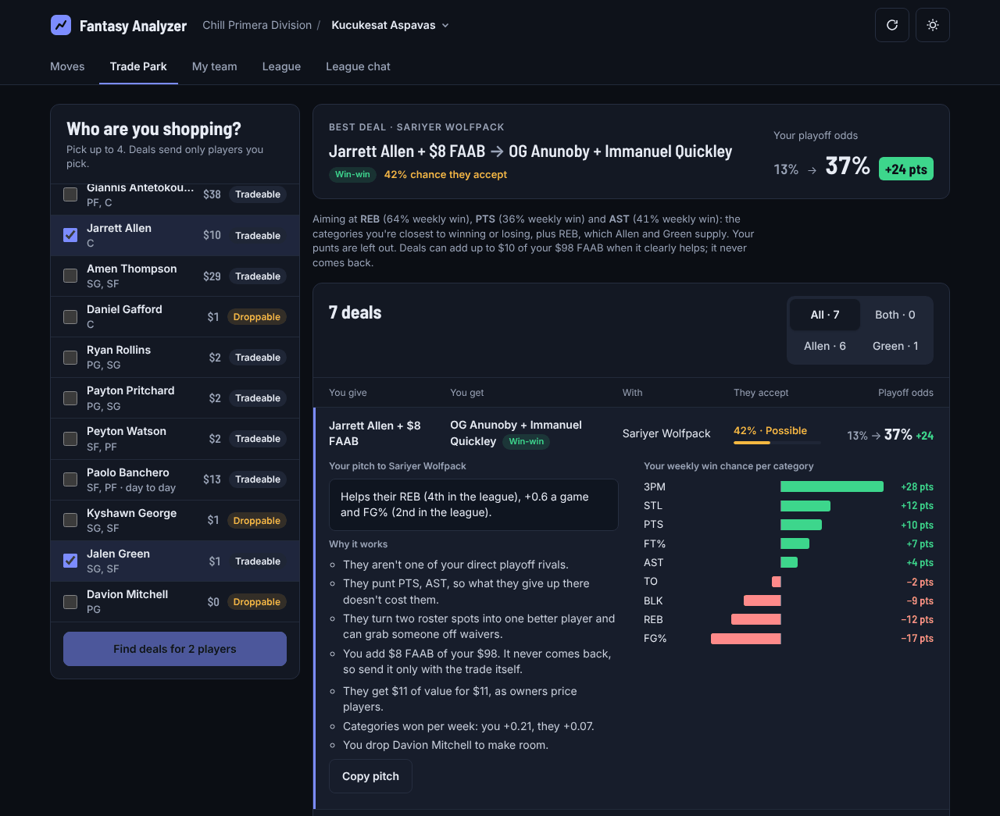
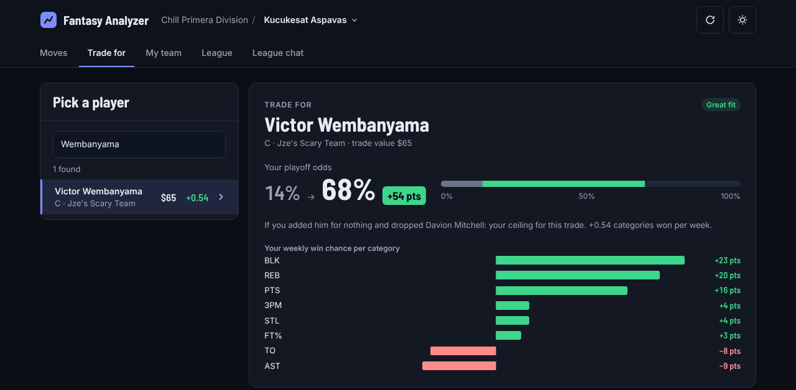
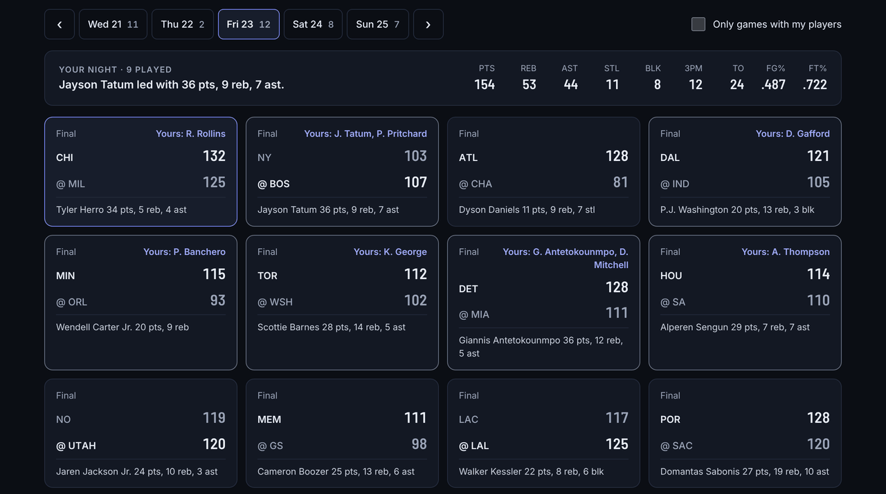
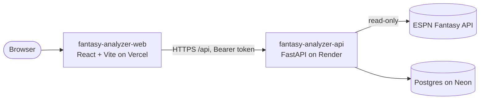

<div align="center">

# Fantasy Analyzer · Web

**Win your ESPN fantasy basketball league with trades the other owner will actually accept.**

[](https://github.com/MCantuncer/fantasy-analyzer-web/actions/workflows/ci.yml)
[](https://fantasy-analyzer-web.vercel.app)
[](https://github.com/MCantuncer/fantasy-analyzer-api)

[](https://react.dev)
[](https://www.typescriptlang.org)
[](https://vite.dev)
[](https://tanstack.com/query)
[](https://vitest.dev)
[](https://vercel.com)

[Live app](https://fantasy-analyzer-web.vercel.app) · [Backend](https://github.com/MCantuncer/fantasy-analyzer-api) · [Report a bug](https://github.com/MCantuncer/fantasy-analyzer-web/issues)

</div>

---

## Contents

- [Overview](#overview)
- [Features](#features)
- [Screenshots](#screenshots)
- [Architecture](#architecture)
- [Getting started](#getting-started)
- [Scripts](#scripts)
- [API types](#api-types)
- [Private leagues and security](#private-leagues-and-security)
- [Deployment](#deployment)

## Overview

The web client for Fantasy Analyzer, built for ESPN **9-category head-to-head** leagues. Enter a league ID (or paste your ESPN team page URL), verify your team, and every move is ranked by how much it changes your playoff odds: trades the other owner should accept, free-agent pickups with the right drop, and where your categories stand.

All the modelling happens in [fantasy-analyzer-api](https://github.com/MCantuncer/fantasy-analyzer-api). This app presents it.

## Features

| | Feature | What you get |
| --- | --- | --- |
| 🔁 | **Trade Park** | Pick up to four of your players and see every team's best deal for them, with acceptance odds, a ready-to-send pitch and your playoff odds before and after. |
| 🎯 | **Trade for** | Pick any rostered player: his fit with your build, his owner's needs, and three offers (best, safer, cheaper). |
| 📊 | **My team** | How often you win each category in an average week (locked, swing or losing), your roster's trade and category value, and keepers that are never offered or dropped. |
| 🛒 | **Pickups** | Free agents paired with the right drop and their effect on your playoff odds. |
| 🏆 | **League** | Every team's build and punts, and simulated standings and playoff odds. |
| ⭐ | **Trade of the day** | One league-wide win-win trade between any two teams, the same for everyone that day, with a "Would you take it?" poll. |
| 🏀 | **Scores** | Live NBA scores and box scores, each player tagged with his fantasy team, plus your games still to play this week. |
| 📰 | **NBA News** | Injuries, trades and role changes checked against several sources, and who gains minutes when a player is out. |
| 💬 | **Moves feed and league chat** | Claims, bids, adds, drops and trades, with reactions, replies and trade votes for verified managers. |
| 🔐 | **Accounts** | Email or Google sign-in, followed leagues, and team verification through ESPN. |
| 🌗 | **Light and dark themes** | Designed for data-heavy screens on desktop and phone. |

## Screenshots

<table>
  <tr>
    <td width="50%"></td>
    <td width="50%"></td>
  </tr>
  <tr>
    <td align="center"><b>Trade Park</b></td>
    <td align="center"><b>Trade for</b></td>
  </tr>
  <tr>
    <td colspan="2"></td>
  </tr>
  <tr>
    <td colspan="2" align="center"><b>Scores</b></td>
  </tr>
</table>

## Architecture



```text
src/
├── api/          Typed client and OpenAPI-generated types (schema.d.ts)
├── components/   One component per screen and widget (TradePark, TradeFor, Scores, News, ...)
├── lib/          Pure helpers: formatting, credentials, ESPN URL parsing, feed and news logic
└── test/         Vitest setup and shared fixtures
```

- **Data fetching:** [TanStack Query](https://tanstack.com/query) for caching, retries and background refresh.
- **Types end to end:** request and response types are generated from the backend's OpenAPI schema, so an API change breaks the build instead of the app.
- **Testing:** Vitest and Testing Library, run in CI with lint and a full type-checked build on every pull request.

## Getting started

**Prerequisites:** Node.js 22 and a running backend (see the [API README](https://github.com/MCantuncer/fantasy-analyzer-api#getting-started); it listens on port 8000).

```sh
npm install
npm run dev
```

Open http://localhost:5173. In development, `/api` is proxied to `http://localhost:8000`.

To point a build at a deployed backend:

```sh
VITE_API_URL=https://your-api.example.com npm run build
```

## Scripts

| Command | What it does |
| --- | --- |
| `npm run dev` | Start the dev server with hot reload |
| `npm test` | Run unit and component tests (Vitest) |
| `npm run lint` | Lint with ESLint |
| `npm run build` | Type-check and build for production |
| `npm run preview` | Serve the production build locally |
| `npm run gen:api` | Regenerate API types from `src/api/openapi.json` |

## API types

`src/api/schema.d.ts` is generated from the backend's OpenAPI schema. After the API changes, copy its `openapi.json` to `src/api/openapi.json` and run:

```sh
npm run gen:api
```

## Private leagues and security

When ESPN says a league is private, the app asks for the user's `espn_s2` and `SWID` cookies and explains where to find them.

- They are kept in `sessionStorage` (gone when the tab closes), or in `localStorage` only if the user ticks "Remember on this device". "Forget ESPN cookies" clears both.
- They are sent to the backend in request headers, never in the URL. Shareable links contain only the league and team IDs.
- Production builds ship a strict Content Security Policy with no third-party scripts, to limit the risk of the cookies being read by injected code.

## Deployment

Deployed on [Vercel](https://vercel.com) at **https://fantasy-analyzer-web.vercel.app**.

1. Add New > Project, and import this repository.
2. Set the environment variable `VITE_API_URL` to the API's public URL (for example `https://fantasy-analyzer-api.onrender.com`).
3. Vercel rebuilds on every push to `main`.

`vercel.json` adds security headers; the Content Security Policy is built into the page and only allows calls to `VITE_API_URL`.
