<div align="center">

# COURT · Web

**Win your ESPN fantasy basketball league with trades the other owner will actually accept.**

[](https://github.com/MCantuncer/fantasy-analyzer-web/actions/workflows/ci.yml)
[](https://fantasy-analyzer-web.vercel.app)
[](https://github.com/MCantuncer/fantasy-analyzer-api)

[](https://react.dev)
[](https://www.typescriptlang.org)
[](https://vite.dev)
[](https://tanstack.com/query)
[](https://vitest.dev)
[](https://vercel.com)

[Live app](https://fantasy-analyzer-web.vercel.app) · [Backend](https://github.com/MCantuncer/fantasy-analyzer-api) · [Report a bug](https://github.com/MCantuncer/fantasy-analyzer-web/issues)

</div>

---

## Contents

- [Overview](#overview)
- [Features](#features)
- [Screenshots](#screenshots)
- [Architecture](#architecture)
- [Getting started](#getting-started)
- [Scripts](#scripts)
- [API types](#api-types)
- [Private leagues and security](#private-leagues-and-security)
- [Deployment](#deployment)

## Overview

The web client for COURT (**C**ategories, **O**dds, **U**pgrades, **R**osters, **T**rades), built for ESPN **9-category head-to-head** leagues. Enter a league ID (or paste your ESPN team page URL), verify your team, and every move is ranked by how much it changes your playoff odds: trades the other owner should accept, free agents paired with the right drop, and where your categories stand.

All the modelling happens in [fantasy-analyzer-api](https://github.com/MCantuncer/fantasy-analyzer-api). This app presents it.

## Features

| | Feature | What you get |
| --- | --- | --- |
| ⚡ | **Moves** | Your best move today (a pickup or a trade) with your playoff odds before and after, trades to offer (Fair, where both teams' odds rise, and Bold, a win on paper for them), and how often you win each category. |
| 🔁 | **Trade Park** | Pick up to four of your players and see every team's best deal for them, with acceptance odds, a ready-to-send pitch and your playoff odds before and after. |
| 🧊 | **Injury risk** | Players who keep missing games carry an amber durability score (tap it for what it means), and every trade's odds count them for fewer games. |
| 🎯 | **Trade For** | Pick any rostered player: his fit with your build, his owner's needs, and three offers (best, safer, cheaper). |
| 📊 | **My Team** | **My Players** on top: your ESPN lineup slot by slot, each player live (lit only while he is on the floor), final, later or idle with his game and line, refreshed every minute so moves made in ESPN show up. Before tip-off each row shows the matchup with the tip time and a countdown, plus one quiet line of his season points, rebounds and assists; one line on top gives the next tip and who sits, and players without a game show when they play next; on phones every stat carries its own label; plus a swap nudge when a bench player plays and a starting slot has no game. Then how often you win each category in an average week (locked, swing or losing), your roster's trade and category value, and keepers that are never offered or dropped. |
| 🛒 | **FA Targets** | Free agents paired with the right drop, their effect on your playoff odds, and the best day to add them. |
| 🃏 | **Player cards** | Tap any player's name for his latest games, health, news and every move of him in your league. |
| 📝 | **Trade feedback and rules** | Rate a trade idea to have it checked against today's league, and set rules (protect a category, skip a team, no injury-prone players) that hide ideas breaking them. |
| 🏆 | **League** | Every team's build and punts, and simulated standings and playoff odds. |
| 🎬 | **Film Room** | Every finished week in review on the League tab: your tape (score and all nine categories), game balls for the player, team and pickup of the week, standout free agents still on the wire or grabbed, the week's top ten players, every final score and a few awards. |
| ⭐ | **Trade of the day** | One league-wide win-win trade between any two teams, the same for everyone that day, with a "Would you take it?" poll. |
| 📅 | **Projected final** | Who wins your matchup and each category by Sunday, and who to bench on crowded days when more players have games than you have lineup spots. |
| 🏀 | **Scores** | Live NBA scores and box scores, each player tagged with his fantasy team, plus your games still to play this week. |
| 📰 | **NBA News** | Injuries, trades and role changes checked against several sources, and who gains minutes when a player is out. |
| 💬 | **League Chat** | The league's moves feed (claims, bids, adds, drops and trades) and chat, with reactions, replies and trade votes for verified managers. |
| 🔐 | **Accounts** | Email or Google sign-in, followed leagues, and team verification through ESPN. |
| 🩺 | **Site health** (admins) | A crash screen with Reload instead of a blank page, and for admins a private page with daily visitors, pages opened, new accounts and analyses (counted without cookies or ids) plus server and website errors grouped with a count, to mark fixed. |
| 🌗 | **Light and dark themes** | Designed for data-heavy screens on desktop and phone. |

## Screenshots

From a real league (Chill Primera Division), in the dark theme.

<table>
  <tr>
    <td colspan="2">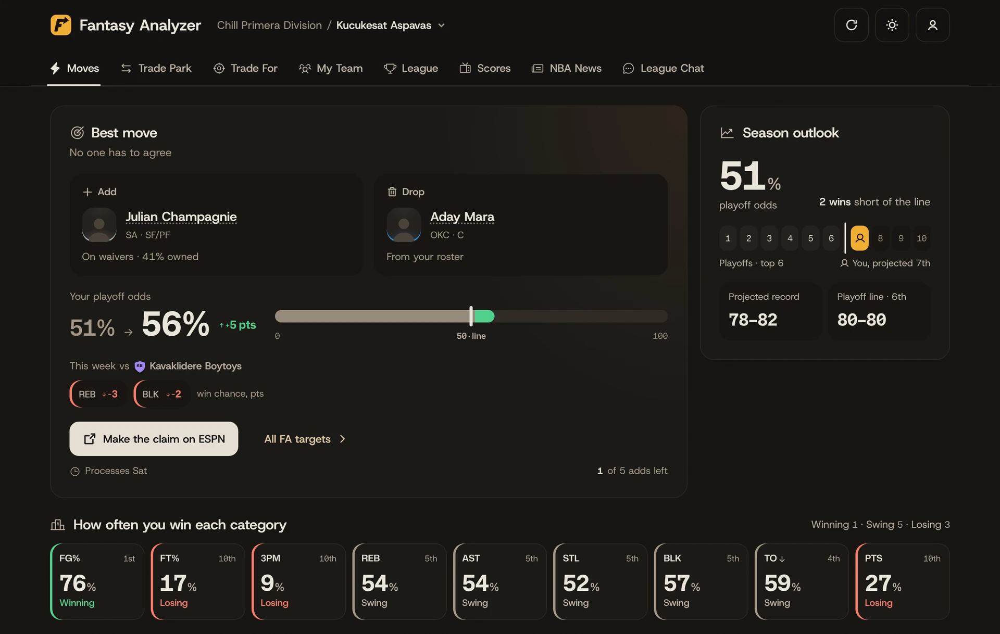</td>
  </tr>
  <tr>
    <td colspan="2" align="center"><b>Moves</b></td>
  </tr>
  <tr>
    <td width="50%">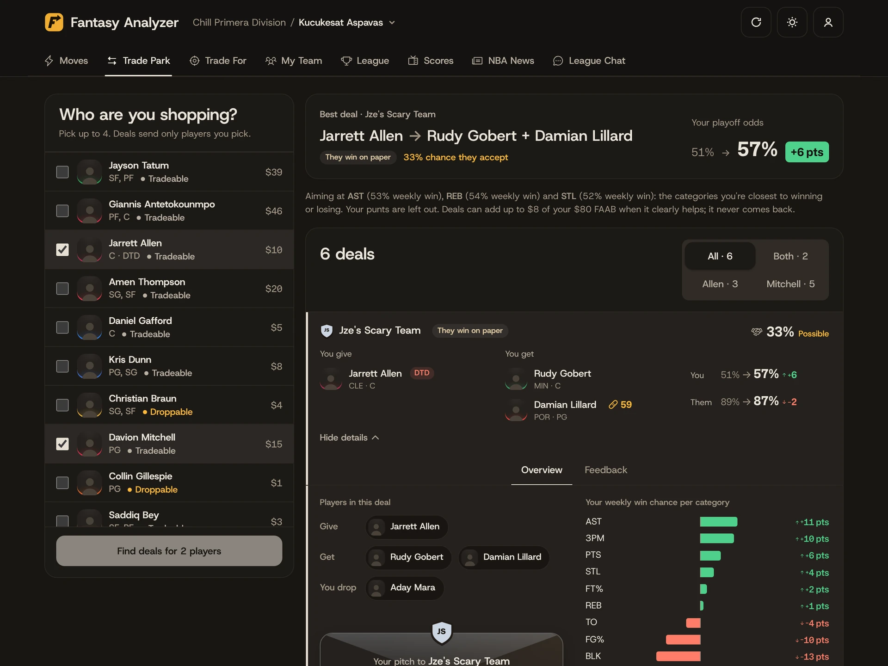</td>
    <td width="50%">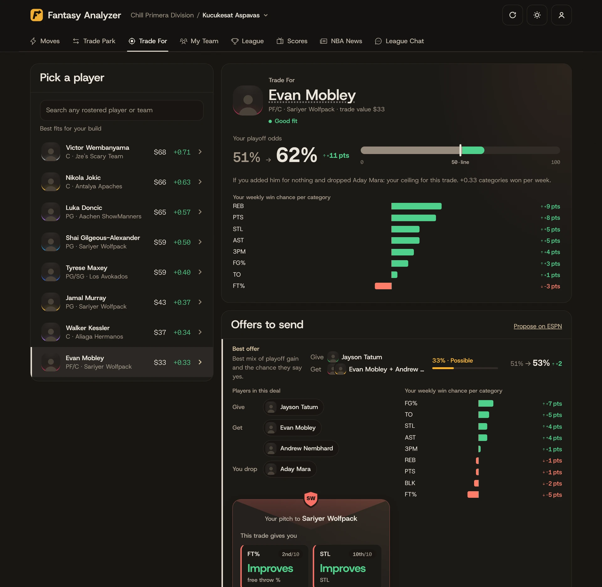</td>
  </tr>
  <tr>
    <td align="center"><b>Trade Park</b></td>
    <td align="center"><b>Trade For</b></td>
  </tr>
  <tr>
    <td width="50%">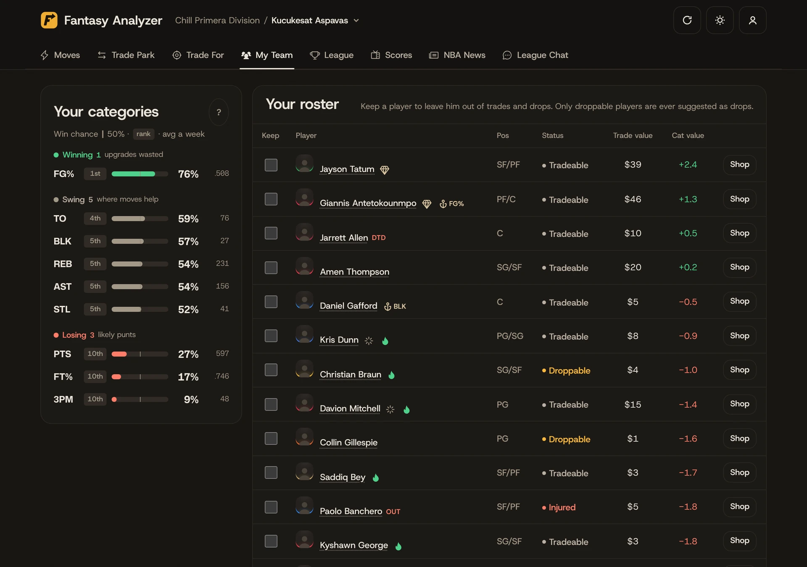</td>
    <td width="50%">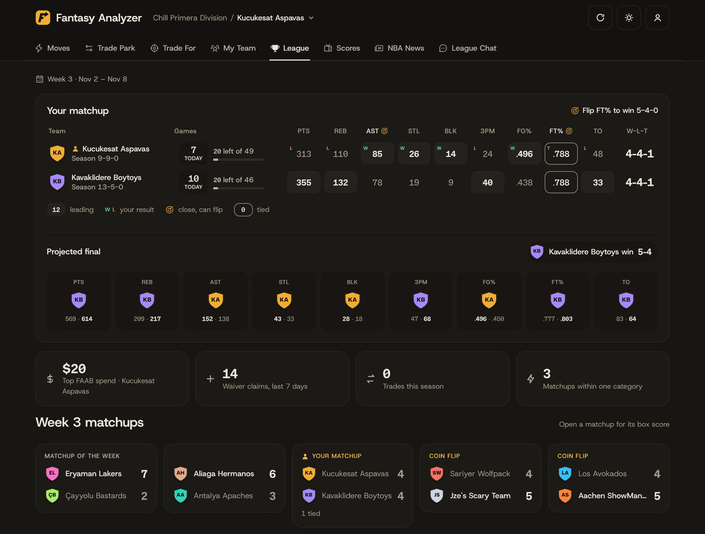</td>
  </tr>
  <tr>
    <td align="center"><b>My Team</b></td>
    <td align="center"><b>League</b></td>
  </tr>
  <tr>
    <td width="50%">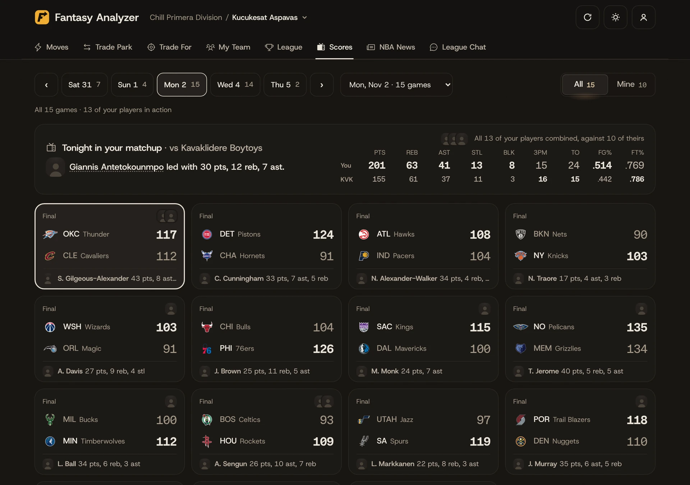</td>
    <td width="50%">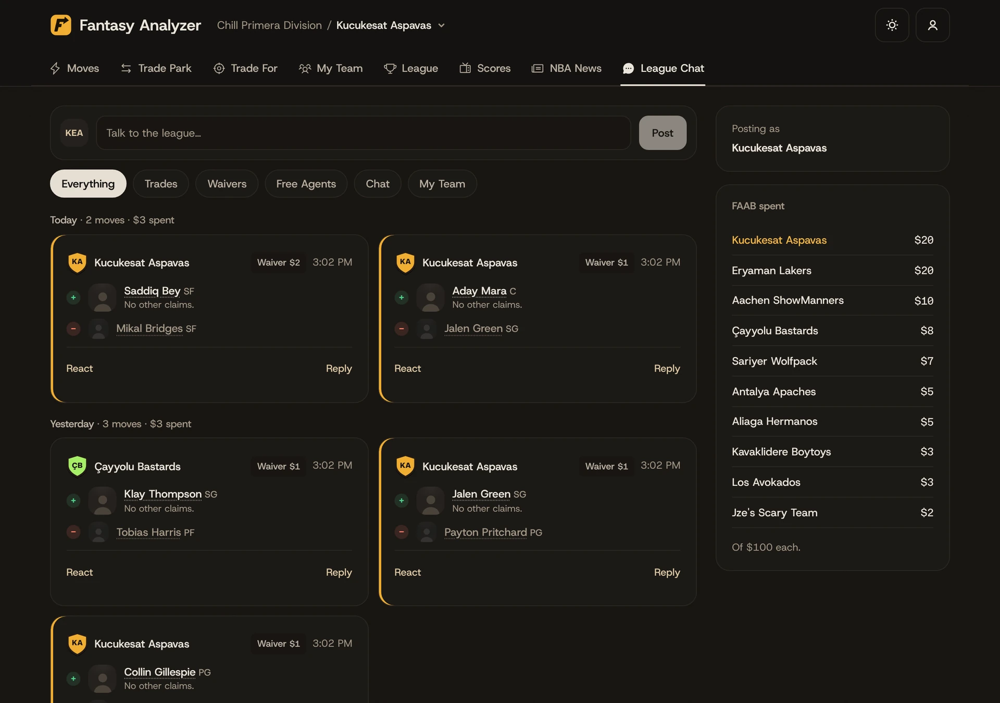</td>
  </tr>
  <tr>
    <td align="center"><b>Scores</b></td>
    <td align="center"><b>League Chat</b></td>
  </tr>
</table>

### On a phone

<table>
  <tr>
    <td width="25%">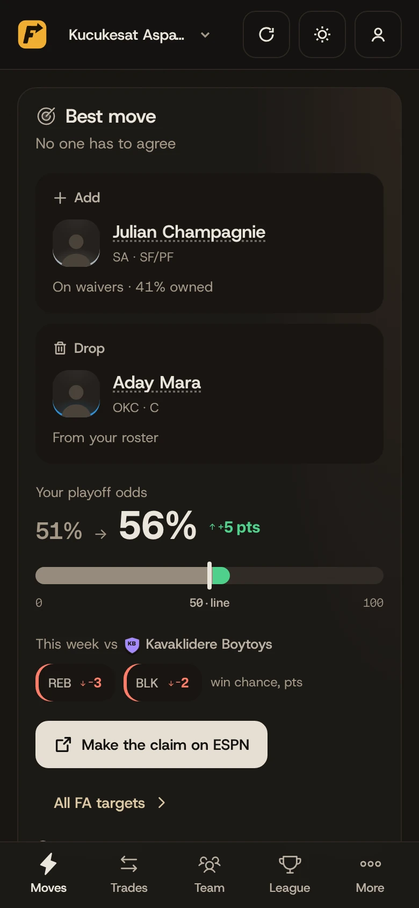</td>
    <td width="25%">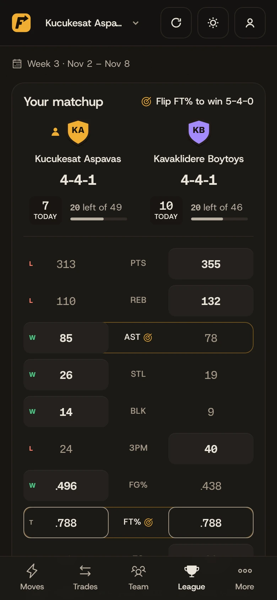</td>
    <td width="25%">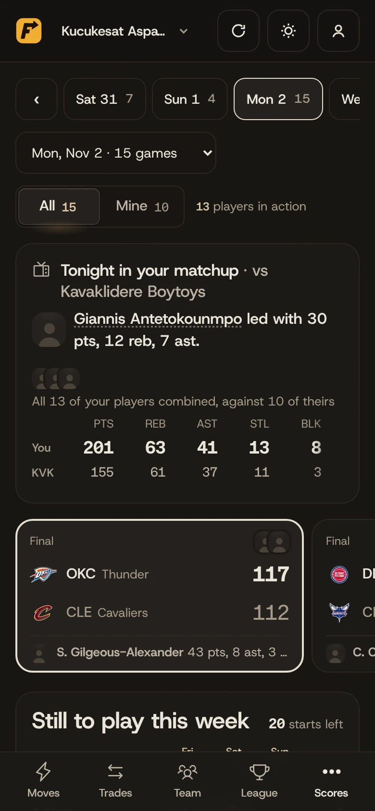</td>
    <td width="25%">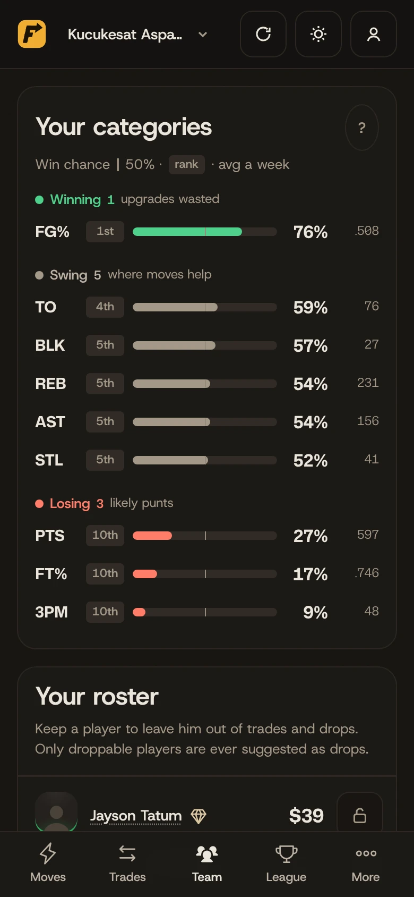</td>
  </tr>
  <tr>
    <td align="center"><b>Moves</b></td>
    <td align="center"><b>League</b></td>
    <td align="center"><b>Scores</b></td>
    <td align="center"><b>My Team</b></td>
  </tr>
</table>

## Architecture

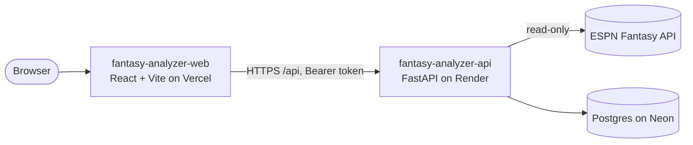

```text
src/
├── api/          Typed client and OpenAPI-generated types (schema.d.ts)
├── components/   One component per screen and widget (TradePark, TradeFor, Scores, News, ...)
├── lib/          Pure helpers: formatting, credentials, ESPN URL parsing, feed and news logic
└── test/         Vitest setup and shared fixtures
```

- **Data fetching:** [TanStack Query](https://tanstack.com/query) for caching, retries and background refresh.
- **Types end to end:** request and response types are generated from the backend's OpenAPI schema, so an API change breaks the build instead of the app.
- **Testing:** Vitest and Testing Library, run in CI with lint and a full type-checked build on every pull request.

## Getting started

**Prerequisites:** Node.js 22 and a running backend (see the [API README](https://github.com/MCantuncer/fantasy-analyzer-api#getting-started); it listens on port 8000).

```sh
npm install
npm run dev
```

Open http://localhost:5173. In development, `/api` is proxied to `http://localhost:8000`.

To point a build at a deployed backend:

```sh
VITE_API_URL=https://your-api.example.com npm run build
```

## Scripts

| Command | What it does |
| --- | --- |
| `npm run dev` | Start the dev server with hot reload |
| `npm test` | Run unit and component tests (Vitest) |
| `npm run lint` | Lint with ESLint |
| `npm run build` | Type-check and build for production |
| `npm run preview` | Serve the production build locally |
| `npm run gen:api` | Regenerate API types from `src/api/openapi.json` |

## API types

`src/api/schema.d.ts` is generated from the backend's OpenAPI schema. After the API changes, copy its `openapi.json` to `src/api/openapi.json` and run:

```sh
npm run gen:api
```

## Private leagues and security

When ESPN says a league is private, the app asks for the user's `espn_s2` and `SWID` cookies and explains where to find them.

- They are kept in `sessionStorage` (gone when the tab closes), or in `localStorage` only if the user ticks "Remember on this device". "Forget ESPN cookies" clears both.
- They are sent to the backend in request headers, never in the URL. Shareable links contain only the league and team IDs.
- Production builds ship a strict Content Security Policy with no third-party scripts, to limit the risk of the cookies being read by injected code.

## Deployment

Deployed on [Vercel](https://vercel.com) at **https://fantasy-analyzer-web.vercel.app**.

1. Add New > Project, and import this repository.
2. Set the environment variable `VITE_API_URL` to the API's public URL (for example `https://fantasy-analyzer-api.onrender.com`).
3. Vercel rebuilds on every push to `main`.

`vercel.json` adds security headers; the Content Security Policy is built into the page and only allows calls to `VITE_API_URL`.
